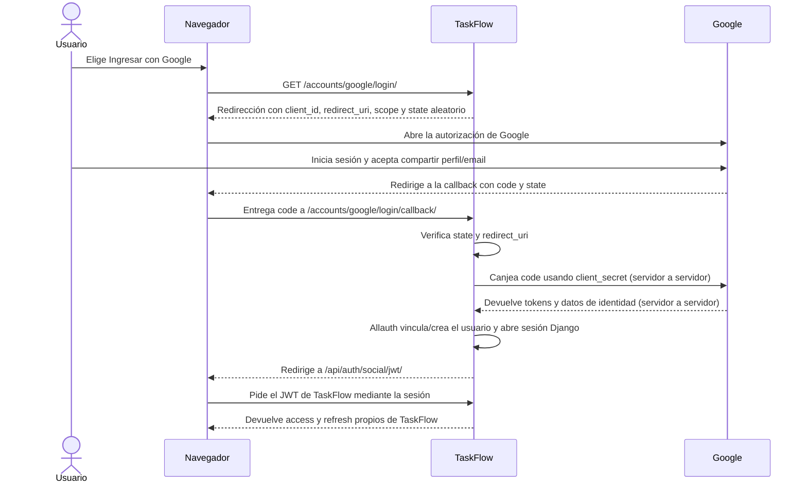

# Flujo de login OAuth con Google

El navegador transporta el código de autorización de un solo uso; el `client_secret` y el canje de tokens quedan entre los servidores. `state` protege la vuelta contra solicitudes inyectadas y los scopes se limitan a `profile` y `email`. La URL de callback local es `http://127.0.0.1:8000/accounts/google/login/callback/`.

Para completar el login real falta crear una aplicación OAuth en Google Cloud y copiar su Client ID y Client Secret al `.env` local. Esos valores no se guardan en el repositorio.
